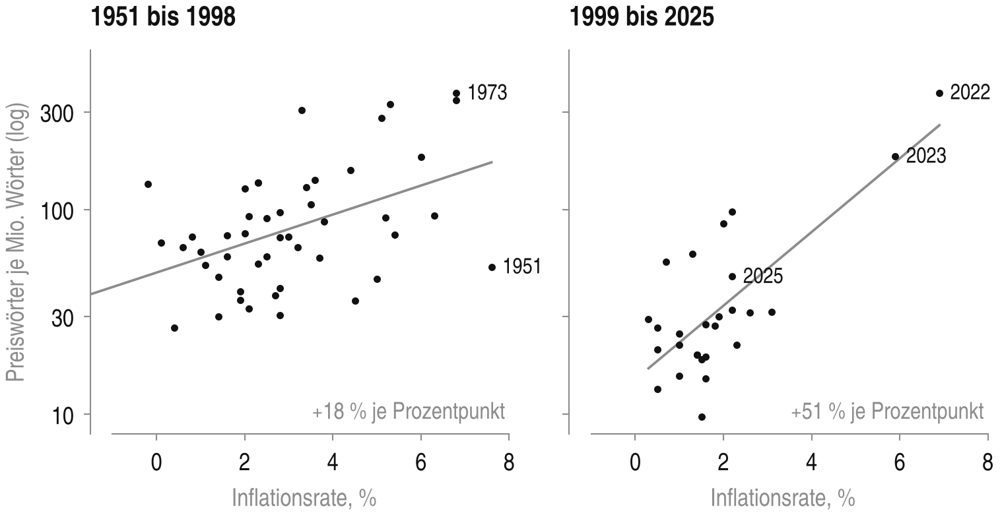

Der Beitrag gibt die persönliche Auffassung des Autors wieder.

### Abstract

In den 1950er und 1960er Jahren fiel in jeder 20. längeren Bundestagsrede ein Wort wie Inflation, Kaufkraftverlust oder Preisstabilität. In den 2000er und 2010er Jahren war es nur noch jede 56., obwohl die Inflation in beiden Zeiträumen meist unter 3 % lag. Der Beitrag zählt solche Wörter in allen 4.610 Plenarprotokollen von 1949 bis 2025. Das Parlament reagiert auf große Inflationsschübe, 1973 und 2022 fast gleich stark. Zwischen den Schüben aber wurde das Preisniveau vom Dauerthema der Bonner Republik zum Ausnahmethema. Die Debatte wanderte zu Energiepreisen und Zinsen. Der Bruch liegt um das Jahr 2000, zeitgleich mit dem Übergang der Geldpolitik auf die Europäische Zentralbank.

JEL-Codes: E31, E58, N14

### Warum die Aufmerksamkeit des Parlaments zählt

Im Herbst 2022 lag die Inflation in Deutschland bei 8,8 % ([Statistisches Bundesamt, 2026](https://api.statistiken.bundesbank.de/rest/data/BBDP1/M.DE.N.VPI.C.A00000.I20.A?format=csv&lang=de)), und der Bundestag sprach so viel über Preise wie zuletzt 1973. Drei Jahre später fielen dort nur noch ein Achtel so viele Preiswörter. Das wirkt selbstverständlich: Steigen die Preise, wird darüber gestritten, sinken sie, wendet sich die Politik anderem zu. Die Protokolle des Bundestages zeigen aber, dass das nicht immer so war. Bis in die 1990er Jahre sprach das Parlament auch in ruhigen Jahren regelmäßig über das Preisniveau, über die Kaufkraft der Löhne, die Stabilität der D-Mark und die Preise, die der Staat selbst festsetzte.

Für Verbraucher, Sparer und die Notenbank ist das keine Nebensache. Was das Parlament debattiert, bestimmt mit, unter welchem politischen Druck Regierung, Tarifparteien und Geldpolitik stehen. Wie stark Haushalte auf Inflation achten, verändert zudem die Wirkung der Geldpolitik ([Pfäuti, 2025](https://doi.org/10.1111/jmcb.13145)). Schweigt das Parlament bei Raten nahe dem Ziel der Notenbank, schützt das deren Unabhängigkeit. Abweichungen vom Ziel könnten dann aber lange ohne öffentliche Kontrolle bleiben. Der Beitrag fragt deshalb, wie oft der Bundestag seit 1949 über das Preisniveau gesprochen hat und ob sich das Grundniveau zwischen den Inflationsschüben verändert hat.

Für Haushalte und Medien gibt es solche Maße, für das Parlament bisher nicht. Gemessen wird die Inflationsaufmerksamkeit über Suchanfragen und Twitter ([Korenok et al., 2026](https://doi.org/10.1162/rest_a_01402)), Zeitungsberichte ([Lamla & Lein, 2014](https://doi.org/10.1016/j.jebo.2014.05.004); [Aarab et al., 2025](https://www.ecb.europa.eu/press/economic-bulletin/focus/2025/html/ecb.ebbox202506_05~b5c5ed8127.en.html)) und Umfragen ([Bracha & Tang, 2025](https://doi.org/10.1093/restud/rdae063)). Textanalysen zum Bundestag gibt es für Fiskalpolitik ([Latifi et al., 2024](https://doi.org/10.1016/j.euroecorev.2024.104827)) und das Thema Zukunft ([Küsters & Andritzky, 2024](https://doi.org/10.2478/wd-2024-0069)), dazu Analysen von Anhörungen der Zentralbanken ([Fraccaroli et al., 2020](https://www.ecb.europa.eu/pub/pdf/scpwps/ecb.wp2442~e78be127c0.en.pdf)) und der Inflationsrhetorik kanadischer Abgeordneter ([Rancourt et al., 2025](https://doi.org/10.1093/pa/gsaf052)). Vergleichende Parlamentskorpora reichen meist nur bis in die 1990er Jahre zurück ([Rauh & Schwalbach, 2020](https://doi.org/10.7910/DVN/L4OAKN)), die deutsche Agenda-Forschung codiert Anfragen und Gesetze erst ab 1978 und nicht nach Inflation ([Breunig & Schnatterer, 2019](https://doi.org/10.1093/oso/9780198835332.003.0010)). Die politikwissenschaftliche Forschung beschreibt Aufmerksamkeit als Folge von Schüben und Abklingen, so [Downs (1972)](https://fbaum.unc.edu/teaching/articles/Downs_Public_Interest_1972.pdf) mit dem Zyklus der Themenaufmerksamkeit und Jones und Baumgartner in *The Politics of Attention* ([Jones & Baumgartner, 2005](https://fbaum.unc.edu/books/attention/Attention_TOC.htm)).

### Wie sich die Aufmerksamkeit messen lässt

Gezählt wird, wie oft Wörter zum Preisniveau im Plenum fallen, je Million gesprochener und protokollierter Wörter. Grundlage ist das Corpus der Plenarprotokolle des Deutschen Bundestages (CPP-BT) in der Fassung vom 19.09.2026 ([Fobbe, 2026](https://doi.org/10.5281/zenodo.22844952)). Es enthält 4.610 Protokolle der Jahre 1949 bis 2025; die 43 Sitzungen von Januar bis September 2026 zeigt Abb. 1 gesondert. Die Umrechnung auf eine Million Wörter ist nötig, weil die Protokolle eines Jahres zwischen 1,6 Mio. Wörtern 1961 und 7,0 Mio. Wörtern 2011 umfassen.

Das Wortfeld erfasst nur das Preisniveau als Ganzes. Dazu zählen Inflation und ihre Zusammensetzungen, Deflation, Preisauftrieb, Preisniveau, Preisstabilität, Geldentwertung, Geldwertstabilität, Kaufkraftverlust und Lebenshaltungskosten. Einzelne Preise wie Mieten, Strom oder Brot zählen nicht mit, weil sie in jedem Politikfeld vorkommen. Sie laufen als eigenes Wortfeld mit, ebenso Placebo-Felder für andere Makrothemen, also Wortfelder, die nicht von der Inflation abhängen sollten und so einen Vergleichsmaßstab liefern.

Die Treffer meinen fast immer das Preisniveau. In einer Zufallsstichprobe von 180 Treffern, 20 je Jahrzehnt, trifft das auf 88,9 % zu, vor 1990 auf 87,0 %, ab 1990 auf 91,2 %. Der Rest betrifft meist Preise einzelner Branchen oder übertragene Bedeutungen wie „Inflation von Konzepten“. Die Erstbewertung nahm das Sprachmodell Claude vor; vier Sprachmodelle wiederholten sie an 50 Treffern ohne Kenntnis der Erstbewertung. Fleiss' Kappa, ein Maß der Übereinstimmung mehrerer Codierer jenseits des Zufalls mit dem Höchstwert 1, beträgt 0,90, unter ChatGPT, Gemini und DeepSeek allein 0,93.

Das Wortfeld übersieht wohl rd. ein Fünftel der Stellen zum Preisniveau. Dafür bewerteten fünf Sprachmodelle blind 27 neue Treffer und 27 Zufallsstellen mit allgemeinen Preiswörtern wie „Preis“, „Teuerung“ oder „teurer“, die das Wortfeld nicht erfasst (Fleiss' Kappa 0,96). Unter den 27 übrigen Stellen meint eine das Preisniveau, eine Teuerungszulage von 1953. Hochgerechnet auf 23.475 Treffer und 131.098 Stellen ohne Treffer ergibt das eine Vollständigkeit von rd. 81 %, bei einer Spanne von etwa der Hälfte bis fast zu allen Stellen. Ob das Wortfeld nach 1999 mehr übersieht, lässt sich mit einer Fundstelle weder zeigen noch ausschließen. Komposita mit nur mittelbarem Bezug wie Inflationsausgleichsprämie und Inflationsausgleichsgesetz senken den Wert für 2022 lediglich von 372 auf 350.

Die Inflationsrate ist die jahresdurchschnittliche Veränderung des Preisindex gegenüber dem Vorjahr. Bis 1991 nutze ich den Preisindex für die Lebenshaltung der Vier-Personen-Haushalte von Arbeitern und Angestellten mit mittlerem Einkommen im früheren Bundesgebiet, weil nur er bis 1950 zurückreicht ([Statistisches Bundesamt, 2023](https://www.destatis.de/DE/Themen/Wirtschaft/Preise/Verbraucherpreisindex/Publikationen/Downloads-Verbraucherpreise/verbraucherpreisindex-lange-reihen-pdf-5611103.html)). Ab 1992 folgt der Verbraucherpreisindex für Deutschland ([Statistisches Bundesamt, 2026](https://api.statistiken.bundesbank.de/rest/data/BBDP1/A.DE.N.VPI.C.A00000.I20.A?format=csv&lang=de)).

### Große Schübe, große Debatten

Steigt die Inflation stark, spricht der Bundestag über Preise. Die beiden Gipfel liegen fast gleichauf, mit 371 Preiswörtern je Million Wörter 1973 und 372 im Jahr 2022 (Abb. 1). Ein solches Wort fiel 1973 im Schnitt rd. 19-mal je Sitzung, 2022 rd. 35-mal. Über den ganzen Zeitraum beträgt die Korrelation mit der Inflationsrate 0,57. Ohne die Jahre 1970 bis 1975 und 2022 bis 2023 sinkt sie auf 0,26: Jenseits der Schübe folgt die Debatte der Rate kaum.

![Abb. 1: Preiswörter im Plenum und Inflationsrate, 1949 bis 2025. Oben: Treffer des Wortfelds Preisniveau je Million Wörter der Plenarprotokolle. Unten: Veränderung des Preisindex gegenüber dem Vorjahr, Jahresdurchschnitt. Hohle Punkte: Januar bis September 2026. Gestrichelt: 1 Bundesbankgesetz, 2 Stabilitätsgesetz, 3 Bretton Woods endet, erster Ölpreisschock, 4 zweiter Ölpreisschock, 5 Wiedervereinigung, 6 Euro, 7 Finanzkrise, 8 Corona, 9 Krieg gegen die Ukraine. Quellen: Fobbe (2026); Statistisches Bundesamt; Deutsche Bundesbank; eigene Berechnungen.](../abbildungen/Abb1_Plenum_Inflation.png)

*Alt-Text: Oben, wie oft im Bundestag Wörter wie Inflation fallen, unten die Inflationsrate, 1949 bis 2026. Beide steigen vor allem in den Schüben der 1970er Jahre und 2022, die Preisrede mit fast gleich hohen Gipfeln. Seit 1990 bleibt sie bei niedriger Inflation sehr gering.*

Der Schub der 1970er Jahre begann im Parlament als Debatte über Wechselkurse. Bei festen Kursen im System von Bretton Woods trieben Exportüberschüsse und Devisenzuflüsse die Preise in der Bundesrepublik; eine Aufwertung der D-Mark verbilligte Importe und dämpfte diesen Druck. Im Jahr der Aufwertung 1969 erreichten Wörter wie Aufwertung und Wechselkurs mit 259 je Million Wörter ihren Höchststand, nach 17 im Jahr 1967. 1970 sprang die Reihe der Preiswörter von 93 auf 306, während die Rate von 2,1 % auf 3,3 % stieg. Der erste große Preisschub im Parlament kam damit vor dem Ölpreisschock von 1973 und über den Außenhandel. Ob die Debatte der Rate vorauslief, zeigen Jahresdaten nicht.

### Zwischen den Schüben wurde es still

In ruhigen Jahren spricht das Parlament heute nur noch rd. 40 % so oft über das Preisniveau wie in den 1950er und 1960er Jahren. In Jahren mit Raten unter 3 % kamen von 1953 bis 1969 im Median 64 Preiswörter auf eine Million Wörter, von 1999 bis 2025 noch 26. Die Inflation lag in diesen Jahren im Mittel bei 1,6 % und 1,4 %; an der Rate liegt der Unterschied also nicht. Die Jahre 1953 bis 1969 folgen auch auf keinen großen Schub, das hohe frühe Niveau ist kein bloßes Nachklingen früherer Inflation. Von den Reden mit mindestens 300 Wörtern enthielt in den ruhigen Jahren vor 1999 im Median jede 22. ein Preiswort, von 1999 bis 2020 nur noch jede 56.

Ein Anpassungsmodell bestätigt den Bruch und legt ihn um das Jahr 2000. In diesem Modell hängt die Aufmerksamkeit eines Jahres von der Inflationsrate und vom Vorjahreswert ab; so trennt es die sofortige von der langfristigen Wirkung der Rate (Tab. 1). Ein Strukturbruch darf das Niveau und die Reaktion auf die Rate verschieben. Ein Bruchtest über die Jahre 1975 bis 2005 wählt 2002 (p = 0,001, Bootstrap). Die Konfidenzmenge nach dem Likelihood-Quotienten, also die Menge der Bruchjahre, die mit den Daten vereinbar sind, umfasst die Jahre 1999 bis 2004, nicht aber 1990 ([Eo & Morley, 2015](https://doi.org/10.3982/QE186)). Spalte 1 nutzt 1999, das Jahr des Euro-Starts; Spalte 2 zeigt zum Vergleich 1990. Die Residuen sind nicht autokorreliert (Breusch-Godfrey-Test, p > 0,17).

| Erklärende Größe | (1) Bruch 1999 | (2) Bruch 1990 | (3) nur Redetext | (4) ohne 1951/52 und 2021/23 |
|---|---|---|---|---|
| Inflationsrate | 0,060 (0,079) | 0,078 (0,037) | 0,062 (0,083) | 0,062 (0,052) |
| Rate, zusätzlich ab Bruch | 0,240 (0,000) | 0,142 (0,110) | 0,255 (0,000) | 0,125 (0,119) |
| Niveau, zusätzlich ab Bruch | -0,769 (0,000) | -0,655 (0,009) | -0,757 (0,000) | -0,567 (0,000) |
| Vorjahreswert, log | 0,588 (0,000) | 0,550 (0,000) | 0,582 (0,000) | 0,645 (0,000) |
| Langfristwert bei 2 % | 70 / 34 | 76 / 33 | 82 / 45 | 73 / 30 |
| Beobachtungen | 75 | 75 | 75 | 70 |
| R² | 0,75 | 0,73 | 0,73 | 0,78 |

: Tab. 1: Aufmerksamkeit und Inflationsrate, mit Strukturbruch

Anmerkungen: Abhängige Größe ist der Logarithmus der Treffer je Million Wörter, Jahre 1951 bis 2025. Konstante nicht ausgewiesen. In Klammern p-Werte, HAC-Standardfehler (robust gegen Autokorrelation und wechselnde Streuung) mit drei Lags. Langfristwert: Treffer je Million Wörter im Gleichgewicht bei einer Rate von 2 %, vor und ab dem Bruch. Spalte 3: nur Redetext, bis 2021 aus Open Discourse ([Richter et al., 2023](https://doi.org/10.7910/DVN/FIKIBO)), ab 2022 aus dem Reden-Datensatz des CPP-BT; in den gemeinsamen Jahren 2014 bis 2021 liefern beide fast gleiche Werte. Spalte 4: Bruch 1999, ohne die Korea-Jahre und den jüngsten Schub.

Quellen: Fobbe (2026); Richter et al. (2023); Statistisches Bundesamt; eigene Berechnungen.

Die Halbierung gilt für Jahre mit niedriger Inflation. Weil sich mit dem Niveau auch die Steigung verschiebt, hängt das Ausmaß von der Rate ab. Nach Spalte 1 liegt der Langfristwert nach dem Bruch bei 1 % Inflation bei rd. 28 % des früheren Werts (90-%-Band 17 % bis 38 %), bei 2 % bei rd. 49 % (36 % bis 73 %). Ab 3 % lassen sich die beiden Zeiträume nicht mehr unterscheiden. Der Befund bleibt in vier weiteren Prüfungen: ohne je eine der fünf Inflationsepisoden, mit dem Index aller privaten Haushalte ab 1964, mit der Höchstrate der vorangegangenen zehn Jahre als Maß des Inflationsgedächtnisses und ohne die Jahre 1990 bis 1998 mit der Debatte über den Vertrag von Maastricht. Auch ohne die Wörter Preisstabilität und Geldwertstabilität ändert er sich nicht.

Dass das Parlament seit dem Bruch stärker auf Schübe reagiert, ist dagegen nicht gesichert. Ohne den jüngsten Schub halbiert sich der Zusatzeffekt der Rate und ist nicht mehr signifikant (Tab. 1, Spalte 4); er beruht auf einer Episode. In Abb. 2 liegt die Punktwolke nach 1999 tiefer, ihre Steilheit tragen aber 2022 und 2023. Auch eine Schwelle, ab der die Debatte anspringt, lässt sich nicht sichern. Für Haushalte liegt sie bei 2 % bis 4 % ([Korenok et al., 2026](https://doi.org/10.1162/rest_a_01402); [Pfäuti, 2024](https://doi.org/10.48550/arXiv.2308.09480)). Eine Gittersuche ab 1990 findet für den Bundestag 3,7 %, liegt damit aber auf der Mindestbesetzung von fünf Jahren, und ein Bootstrap-Test verwirft das lineare Modell nicht (p = 0,14; [Hansen, 1996](https://doi.org/10.2307/2171789)).

*Alt-Text: Zwei Punktwolken, links 1951 bis 1998, rechts 1999 bis 2025. Rechts liegen die Jahre mit niedriger Inflation deutlich tiefer als links; die Gerade ist rechts steiler, getragen von 2022 und 2023.*

### Keine Frage der Zählweise

Selten geworden ist das Preisniveau, nicht die Wirtschaftspolitik insgesamt. Die Protokolle enthalten Anlagen und Verfahrenstext, deren Anteil sich ändert; auf reinem Redetext ist der Befund derselbe (Tab. 1, Spalte 3). In Jahren mit Raten unter 3 % fielen im Redetext Wörter zu Arbeitslosigkeit, Staatshaushalt und Wachstum nach 1999 nur auf rd. 86 % bis 98 % ihres früheren Medians, Preiswörter dagegen auf rd. 49 %. Misst man die Preisrede an diesen drei Feldern, bleibt der Bruch gesichert, auch ohne die Schübe (p = 0,04). Auch ein Wechsel zu anderen Wörtern für dieselbe Sache erklärt den Rückgang nicht: Ausdrücke wie „Preissteigerung“ oder „Teuerung“ fielen noch stärker, von 35 auf 10 je Million Wörter.

Über Preise spricht das Parlament seither vor allem als Energiepreise. Wörter zu Energiepreisen, Preisbremsen und Heizkosten stiegen vom Median 6 je Million Wörter in den Jahren 1951 bis 1969 auf 59 in den Jahren 2010 bis 2021; 2022 erreichten sie 628. Zugleich verschwand fast das Vokabular, mit dem der Staat früher selbst Preise und Löhne lenken wollte. Wörter wie Konzertierte Aktion, Stabilitätsgesetz, Preisstopp und Lohnleitlinien fielen in ruhigen Jahren auf ein Siebtel.

Den Rückgang tragen alle großen Fraktionen. Nach einer Auswertung mit Open Discourse, einem Datensatz der Reden mit Fraktion und Funktion des Redners, sank der Median in ruhigen Jahren bei der CDU/CSU von 82 auf 36 Preiswörter je Million Wörter, bei der SPD von 73 auf 26 und bei der FDP von 74 auf 43. Neue Fraktionen mit anderen Themen erklären ihn also nicht. In den Schüben ist das Preisniveau vor allem ein Thema der Opposition, 1973 mit 905 gegen 263 Preiswörter je Million Wörter, 2022 mit 658 gegen 356. Bei gleicher Partei und gleichem Jahr sprechen Regierungsparteien rd. 13,5 % weniger über Preise als in der Opposition (p < 0,01). Nach 1999 ändert sich dieser Abstand nicht.

### Warum es still wurde: drei mögliche Erklärungen

Am nächsten liegt die Übertragung der Geldpolitik an die Europäische Zentralbank (EZB). Seit der Währungsunion entscheidet keine deutsche Institution mehr allein über die Zinsen, und das Preisniveau könnte deshalb aus dem parlamentarischen Alltag verschwunden sein. Dazu passt, dass die Konfidenzmenge des Bruchjahrs 1999 bis 2004 umfasst und nicht 1990. Die Aufmerksamkeit dürfte dabei teils zum Instrument gewandert sein: Wörter zu Zins und Geldpolitik stiegen nach 1999 in ruhigen Jahren um ein Viertel bis die Hälfte, und Politiker kommentieren die Geldpolitik der EZB meist mit dem Wunsch nach niedrigeren Zinsen ([Ehrmann & Fratzscher, 2011](https://doi.org/10.1162/REST_a_00113)). Gegen diese Lesart spricht, dass schon die Bank deutscher Länder ab 1948 und die Bundesbank ab 1957 von der Bundesregierung unabhängig waren.

Ebenso könnte der Rückzug des Staates aus der Preispolitik den Rückgang erklären. Bis in die 1980er Jahre versuchten Parlament und Regierung, Preise selbst zu beeinflussen, über das Stabilitätsgesetz von 1967, die Konzertierte Aktion von Staat, Gewerkschaften und Arbeitgebern und staatlich festgesetzte Preise. Preisstabilität war damit Teil des Parteienstreits ([Barkhausen & Teupe, 2025](https://doi.org/10.1515/jbnst-2023-0045)). Der Einbruch dieses Vokabulars stützt die Lesart. Ihr Zeitpunkt passt aber schlechter, denn die Konzertierte Aktion endete schon 1977.

Schließlich könnte die Disinflation in vielen Industrieländern seit den 1990er Jahren den Rückgang tragen. Mit niedrigeren, stabileren Raten und fester verankerten Erwartungen wäre weniger Preisrede auch ohne Währungsunion zu erwarten. Ein Land allein kann diese drei Erklärungen nicht trennen; dafür bräuchte es Parlamente innerhalb und außerhalb des Euroraums.

### Nach 2022: schnelle Rückkehr zur Stille

Nach dem Schub von 2022 kehrte das Parlament so schnell zum Grundniveau zurück, wie es die Rate erwarten lässt. Haushalte verhalten sich anders. Nach [Korenok und Munro (2024)](https://ideas.repec.org/p/zbw/glodps/1463.html) bleibt ihre Aufmerksamkeit nach dem Rückgang der Inflation zwei- bis dreimal so hoch wie vor dem Anstieg, für Nachrichten beschreibt die EZB Ähnliches ([Aarab et al., 2025](https://www.ecb.europa.eu/press/economic-bulletin/focus/2025/html/ecb.ebbox202506_05~b5c5ed8127.en.html)). Im Bundestag lag die Reihe 2025 mit 47 Preiswörtern je Million Wörter zwar beim 2,4-Fachen des Mittels der Jahre 2015 bis 2020. Die Rate war mit 2,2 % aber auch etwa doppelt so hoch. Das Modell aus Tab. 1, Spalte 1, erwartet für 2025 sogar 68 und für Januar bis September 2026 genau den beobachteten Wert von 50.

Anfragen sind für diese Frage ein schlechter Ersatz. Unter allen 43.866 Kleinen und Großen Anfragen im Dokumentations- und Informationssystem für Parlamentsmaterialien (DIP) tragen nur 15 das Preisniveau oder seine Messung im Titel, von 1949 bis 1995 nur zwei, 1971 und 1972. Ein Maß auf Grundlage der Anfragetitel verfehlte damit den ersten Ölpreisschock. Den Inhalt von Anfragen codieren dagegen [Kristensen et al. (2023)](https://doi.org/10.1017/S0143814X22000307) für sieben Länder.

### Was daraus folgt

Für die Geldpolitik dürfte die Stille ein zweischneidiger Befund sein. Spricht das Parlament bei Raten nahe dem Ziel kaum über das Preisniveau, schützt das die Notenbank vor kurzfristigem Druck. Abweichungen vom Ziel könnten dann aber lange ohne Debatte bleiben. In den 2010er Jahren mit zu niedriger Inflation sprach der Bundestag eher über Zinsen als über Preise. Ob diese Stille Vertrauen oder Desinteresse ausdrückt, zeigen die Daten nicht. Der formale Ort der Rechenschaft der EZB ist ohnehin das Europäische Parlament.

Für die Wirtschaftsgeschichte zeigt die Reihe einen Wandel der parlamentarischen Stabilitätsdebatte. Das Preisniveau war in der Bonner Republik ein Dauerthema des Parlaments und ist es seit etwa 2000 nicht mehr. Der Wandel erfasst alle Fraktionen und fällt zeitlich mit der Währungsunion zusammen. Ob die Delegation, der Rückzug staatlicher Preissteuerung oder die weltweite Disinflation ihn trägt, bleibt offen.

Für die Forschung sind Plenarprotokolle eine unterschätzte Quelle. Sie liegen maschinenlesbar und lückenlos seit 1949 vor, sind frei von Erhebungseffekten und messen, was politisch verhandelt wird.

### Grenzen

Das Maß misst Häufigkeit, nicht Haltung. Es unterscheidet nicht, ob jemand vor Inflation warnt oder sie für überschätzt hält. Trefferqualität und Vollständigkeit haben Sprachmodelle geprüft; eine menschliche Codierung steht aus, und die Schätzung der Vollständigkeit beruht auf einer kleinen Stichprobe. Die Schübe von 1973 und 2022 kamen auch über die Energiepreise; die Reihe trennt Aufmerksamkeit für das Preisniveau nicht vollständig von Aufmerksamkeit für Energie. Frühe Protokolle stammen aus der Texterkennung; Lesefehler senken eher die frühen Werte und wirken gegen den Befund. Jahresdaten mit 75 Beobachtungen und wenigen Episoden erlauben keine Aussage über eine allgemeine Reaktion auf die Rate. Daten und Skripte liegen offen unter [github.com/hungerland-macro/PREISREDE](https://github.com/hungerland-macro/PREISREDE).

### Hinweis zum Einsatz von KI

Bei der Erstellung des Beitrags kam das Sprachmodell Claude (Anthropic) zum Einsatz. Es schrieb nach Vorgaben des Autors die Python-Skripte für den Abruf der Anfragen, die Wortzählungen, die Schätzungen und die Abbildungen, entwarf Teile des Textes, prüfte Zahlen und Literaturangaben gegen die Originalquellen und redigierte den Text. Es nahm die Erstbewertung der Trefferstichprobe vor und schlug die Einteilung der 78 Anfragen mit Preiswort im Titel vor, die der Autor übernahm. Die blinde Wiederholung beider Bewertungen übernahmen ChatGPT, Gemini, DeepSeek und Claude in getrennten Sitzungen ohne Kenntnis der Erstcodierung, die Prüfung der Vollständigkeit zusätzlich Grok. Fragestellung, Wortfelder, Deutung der Ergebnisse und die Endfassung verantwortet der Autor.

### Literatur

Aarab, I., Bańbura, M., Bobeica, E. & Leguay, E. (2025). [Monitoring attention to inflation in the news](https://www.ecb.europa.eu/press/economic-bulletin/focus/2025/html/ecb.ebbox202506_05~b5c5ed8127.en.html). *Economic Bulletin*, 6/2025, Box 5. Europäische Zentralbank.

Barkhausen, D. & Teupe, S. (2025). [The German inflation trauma: Weimar's policy lessons between persistence and reconstruction](https://doi.org/10.1515/jbnst-2023-0045). *Jahrbücher für Nationalökonomie und Statistik*, *245*(3), 269-332.

Bracha, A. & Tang, J. (2025). [Inflation levels and (in)attention](https://doi.org/10.1093/restud/rdae063). *Review of Economic Studies*, *92*(3), 1564-1594.

Breunig, C. & Schnatterer, T. (2019). [Political agendas in Germany](https://doi.org/10.1093/oso/9780198835332.003.0010). In F. R. Baumgartner, C. Breunig & E. Grossman (Hrsg.), *Comparative policy agendas: Theory, tools, data* (S. 97-104). Oxford University Press.

Downs, A. (1972). [Up and down with ecology: The “issue-attention cycle”](https://fbaum.unc.edu/teaching/articles/Downs_Public_Interest_1972.pdf). *The Public Interest*, *28*, 38-50.

Ehrmann, M. & Fratzscher, M. (2011). [Politics and monetary policy](https://doi.org/10.1162/REST_a_00113). *Review of Economics and Statistics*, *93*(3), 941-960.

Eo, Y. & Morley, J. (2015). [Likelihood-ratio-based confidence sets for the timing of structural breaks](https://doi.org/10.3982/QE186). *Quantitative Economics*, *6*(2), 463-497.

Fobbe, S. (2026). [*Corpus der Plenarprotokolle des Deutschen Bundestages (CPP-BT)*](https://doi.org/10.5281/zenodo.22844952) (Version 2026-09-19) [Datensatz]. Zenodo.

Fraccaroli, N., Giovannini, A. & Jamet, J.-F. (2020). [*Central banks in parliaments: A text analysis of the parliamentary hearings of the Bank of England, the European Central Bank and the Federal Reserve*](https://www.ecb.europa.eu/pub/pdf/scpwps/ecb.wp2442~e78be127c0.en.pdf) (ECB Working Paper Nr. 2442). Europäische Zentralbank.

Hansen, B. E. (1996). [Inference when a nuisance parameter is not identified under the null hypothesis](https://doi.org/10.2307/2171789). *Econometrica*, *64*(2), 413-430.

Jones, B. D. & Baumgartner, F. R. (2005). [*The politics of attention: How government prioritizes problems*](https://fbaum.unc.edu/books/attention/Attention_TOC.htm). University of Chicago Press.

Korenok, O. & Munro, D. (2024). [*The rockets and feathers of inflation attention*](https://ideas.repec.org/p/zbw/glodps/1463.html) (GLO Discussion Paper Nr. 1463). Global Labor Organization.

Korenok, O., Munro, D. & Chen, J. (2026). [Inflation and attention thresholds](https://doi.org/10.1162/rest_a_01402). *Review of Economics and Statistics*, *108*(3), 842-850.

Kristensen, T. A., Mortensen, P. B., Green-Pedersen, C. & Seeberg, H. B. (2023). [The policy agenda effects of problem indicators: A comparative study in seven countries](https://doi.org/10.1017/S0143814X22000307). *Journal of Public Policy*, *43*(2), 240-260.

Küsters, A. & Andritzky, J. (2024). [Welche Rolle spielt das Thema Zukunft im Bundestag?](https://doi.org/10.2478/wd-2024-0069) *Wirtschaftsdienst*, *104*(4), 252-257.

Lamla, M. J. & Lein, S. M. (2014). [The role of media for consumers' inflation expectation formation](https://doi.org/10.1016/j.jebo.2014.05.004). *Journal of Economic Behavior & Organization*, *106*, 62-77.

Latifi, A., Naboka-Krell, V., Tillmann, P. & Winker, P. (2024). [Fiscal policy in the Bundestag: Textual analysis and macroeconomic effects](https://doi.org/10.1016/j.euroecorev.2024.104827). *European Economic Review*, *168*, 104827.

Pfäuti, O. (2024). [*The inflation attention threshold and inflation surges*](https://doi.org/10.48550/arXiv.2308.09480) (arXiv:2308.09480). arXiv.

Pfäuti, O. (2025). [Inflation – who cares? Monetary policy in times of low attention](https://doi.org/10.1111/jmcb.13145). *Journal of Money, Credit and Banking*, *57*(5), 1211-1239.

Rancourt, M.-A., Déry, A., Fortier-Chouinard, A. & Dufresne, Y. (2025). [Understanding politicians' discourse on inflation and cost of living in Canada](https://doi.org/10.1093/pa/gsaf052). *Parliamentary Affairs*.

Rauh, C. & Schwalbach, J. (2020). [*The ParlSpeech V2 data set: Full-text corpora of 6.3 million parliamentary speeches in the key legislative chambers of nine representative democracies*](https://doi.org/10.7910/DVN/L4OAKN) [Datensatz]. Harvard Dataverse.

Richter, F., Koch, P., Franke, O., Kraus, J., Kuruc, F., Thiem, A., Högerl, J., Heine, S. & Schöps, K. (2023). [*Open Discourse*](https://doi.org/10.7910/DVN/FIKIBO) (Version 4) [Datensatz]. Harvard Dataverse.

Statistisches Bundesamt. (2023). [*Verbraucherpreisindizes für Deutschland. Lange Reihen ab 1948*](https://www.destatis.de/DE/Themen/Wirtschaft/Preise/Verbraucherpreisindex/Publikationen/Downloads-Verbraucherpreise/verbraucherpreisindex-lange-reihen-pdf-5611103.html) (Ausgabe Dezember 2022).

Statistisches Bundesamt. (2026). [*Verbraucherpreisindex für Deutschland, 2020 = 100*](https://api.statistiken.bundesbank.de/rest/data/BBDP1/A.DE.N.VPI.C.A00000.I20.A?format=csv&lang=de) [Datensatz, Jahres- und Monatswerte, abgerufen über die Zeitreihendatenbank der Deutschen Bundesbank, BBDP1.A.DE.N.VPI.C.A00000.I20.A und BBDP1.M.DE.N.VPI.C.A00000.I20.A].
